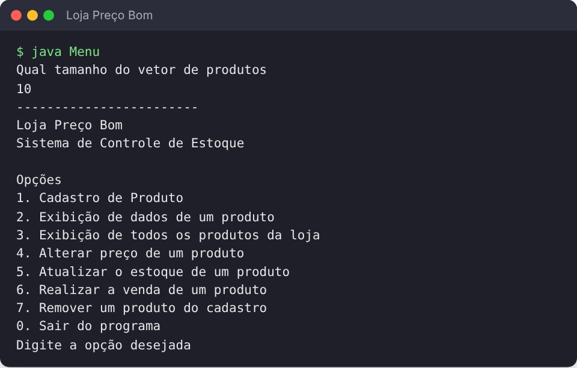

# Loja Preço Bom — Controle de Estoque

Sistema de **controle de estoque** em Java, feito como atividade de revisão de **Programação Orientada a Objetos** na disciplina de **Estrutura de Dados I**. Os produtos ficam em um vetor de tamanho definido pelo usuário, e todas as operações são feitas por um menu no terminal.



## Funcionalidades

1. Cadastro de produto (código, descrição, fornecedor, preço e estoque)
2. Exibição dos dados de um produto
3. Listagem de todos os produtos
4. Alteração de preço por percentual (aumento ou desconto)
5. Atualização do estoque
6. Venda, com baixa no estoque
7. Remoção do cadastro

## Estrutura

| Classe | Responsabilidade |
|---|---|
| `Produto` | Entidade com código, descrição, fornecedor, preço e estoque |
| `CadastroProdutos` | Vetor de produtos com busca por código e as operações do sistema |
| `Menu` | Interface de terminal |

## Como executar

```bash
cd src
javac *.java
java Menu
```

## Tecnologias

Java

---

Feito por [João Pedro Pimenta](https://www.linkedin.com/in/joao-pedro-pimenta/) durante a graduação em Ciência da Computação na UNICAP.
